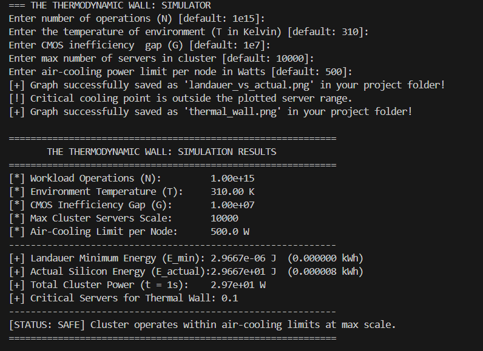
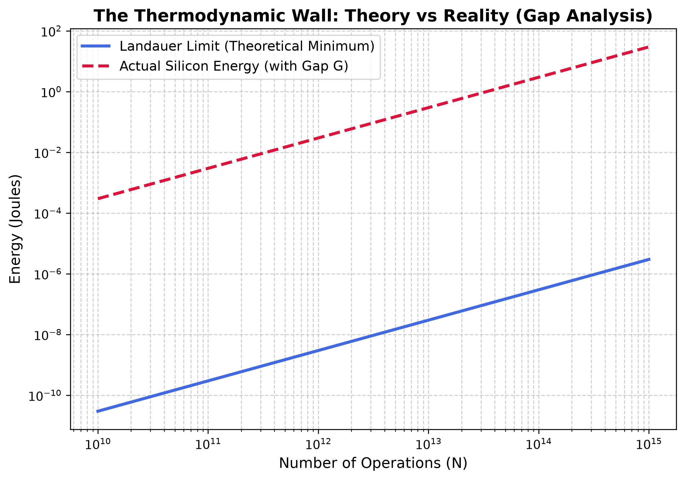
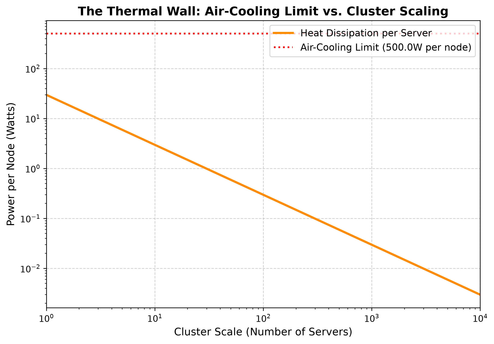

# The Thermodynamic Wall: Modeling the Fundamental Limits of Information Processing and Silicon Dissipation

A Python-based simulator comparing a Landauer-based theoretical energy limit with an estimated energy cost, then evaluating the resulting power demand against a per-server cooling threshold.

### This project outputs:

- **Landauer Minimum Energy**
- **Estimated Energy Consumption**
- **Total Cluster Power**
- **Critical Server Threshold**

**The simulator generates two graphs:**

- **Theoretical Minimum Energy vs. Estimated Energy Consumption:** Theoretical minimum energy required vs. estimated silicon energy consumption.

- **Thermal Wall Scaling:** Air-cooling limits vs. cluster scaling, showing at what server scale the cooling system can no longer keep up with heat dissipation.

---

## Mathematics and Physics Foundation

1. **Landauer’s Principle:** Calculates the theoretical minimum energy associated with the irreversible erasure of one bit of information.

2. **Estimated Energy Consumption:** Calculated by multiplying the Landauer-based energy reference by the user-defined energy overhead multiplier ((G)). This represents an assumed gap between the theoretical limit and estimated energy consumption, not a measured universal property of CMOS transistors.

3. **The Thermal Wall & Cooling Limit:** Calculates the server count at which the modeled power per server reaches the specified cooling threshold. Total power is divided by the cooling limit per server to obtain this threshold.

---

### Model Assumptions

- **Execution Time:** The modeled workload is assumed to take 1 second to complete. Total power is calculated by dividing the estimated energy consumption by this duration.
- **Energy Overhead:** The multiplier (G) represents a user-defined energy overhead relative to the Landauer-based theoretical reference.
- **Cooling Capacity:** The cooling threshold represents a configurable maximum power dissipation per server.

---

## Simulation Methodology and Architecture

- **Input:** Prompts the user for customizable simulation parameters.

- **Validation:** Checks whether the inputs satisfy the program's requirements.

- **Computation:** Calculates the energy and power values, and evaluates the cooling threshold.

- **Output and Visualization:** Prints the results and generates two graphs.

---

## Example Results

## Example Results

### Terminal Output



### Theoretical Minimum Energy vs. Estimated Energy Consumption



### Thermal Wall Scaling



---

## How to Run

### 1. Clone the Repository

```bash
git clone https://github.com/aylinmuzaffarli/thermodynamic-wall-simulator.git
cd thermodynamic-wall-simulator
```

---

### 2. Install Dependencies

```bash
pip install -r requirements.txt
```

### 3. Run the Simulator

```bash
python simulator.py
```

Follow the prompts to enter your simulation parameters. The program will print the calculated results and generate the visualization files.
